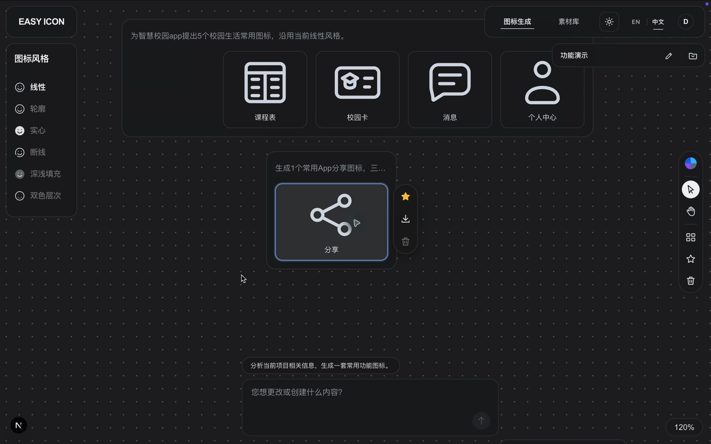
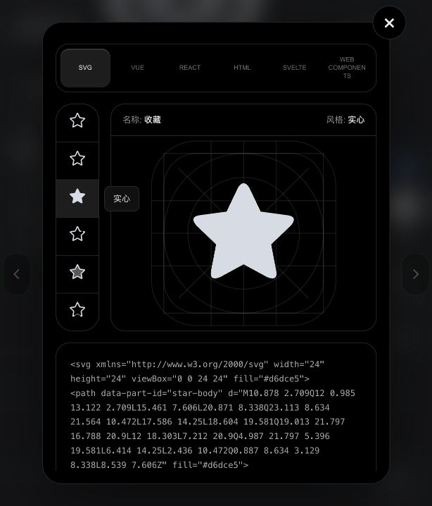
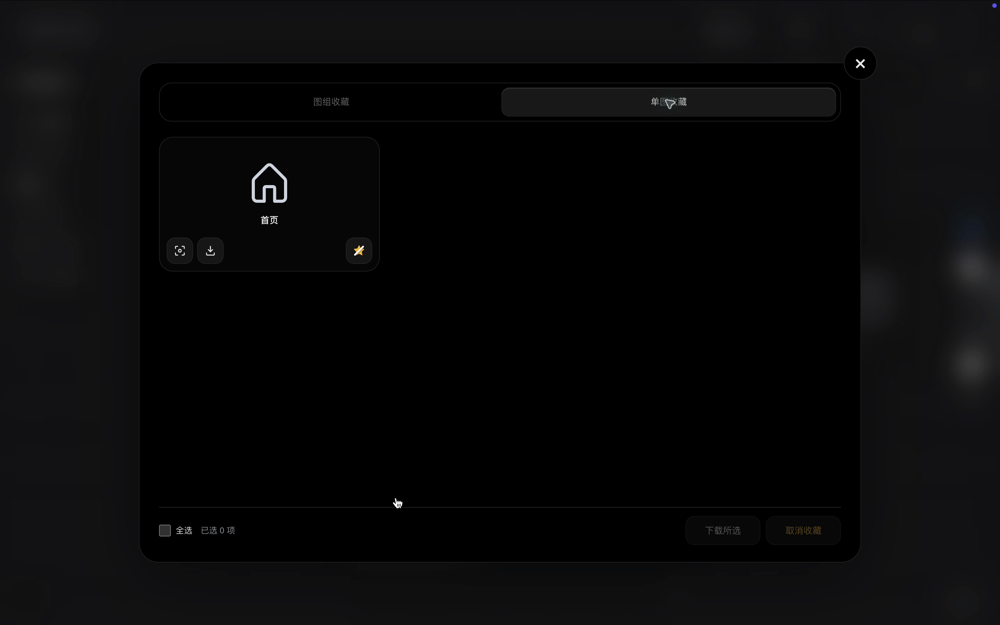
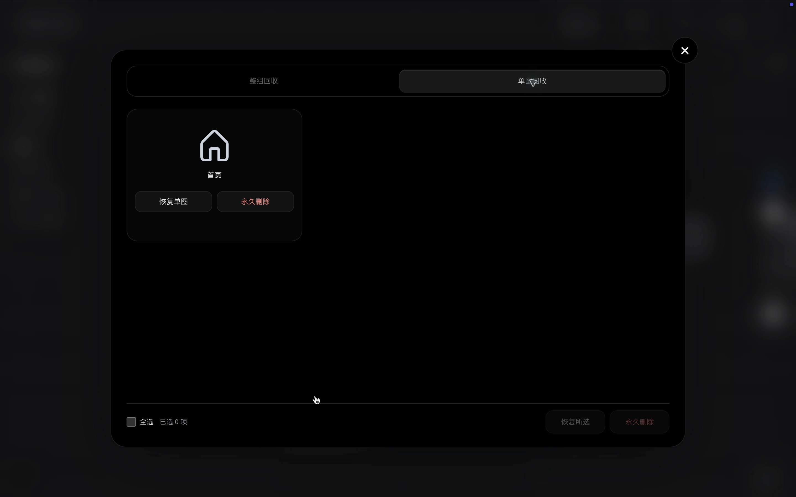
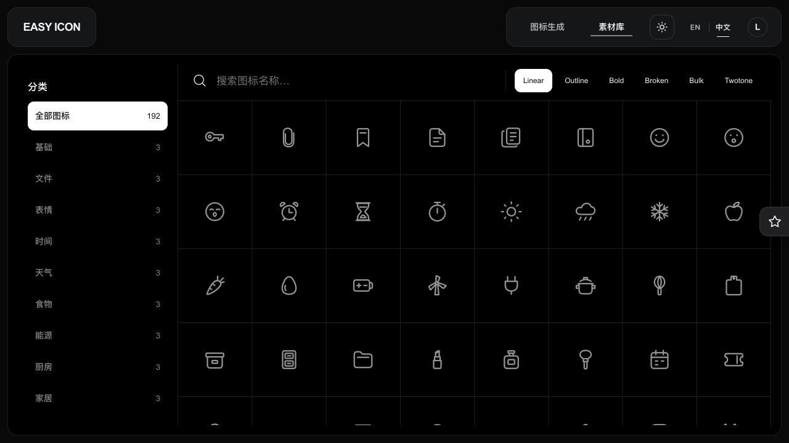
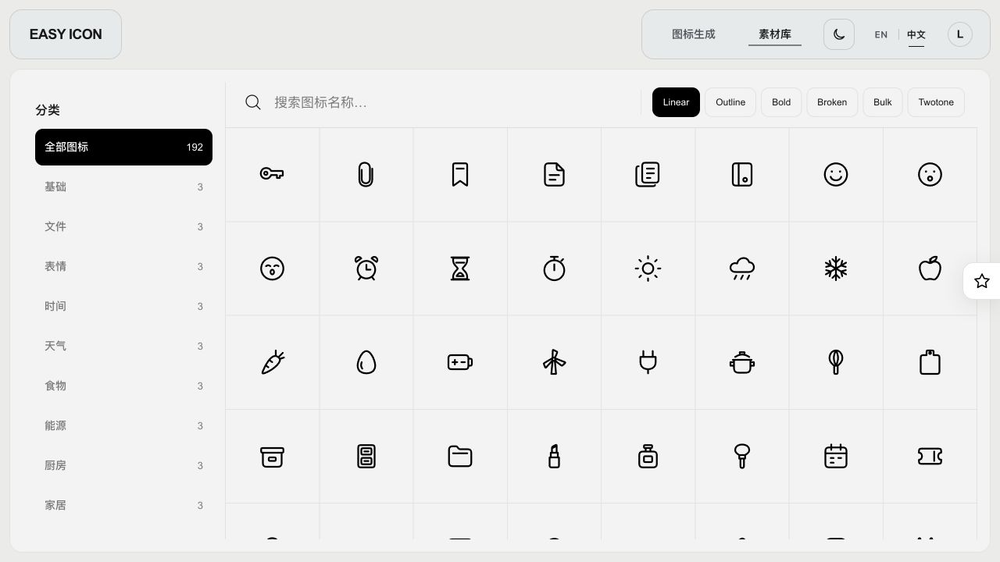
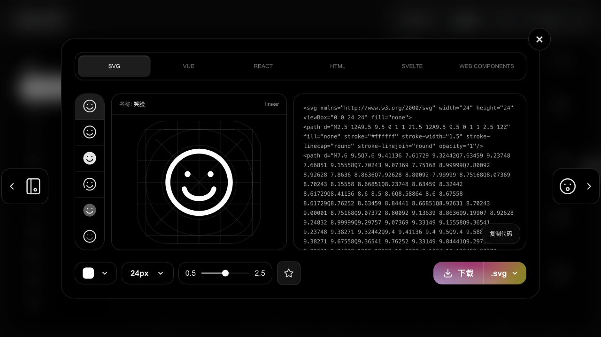
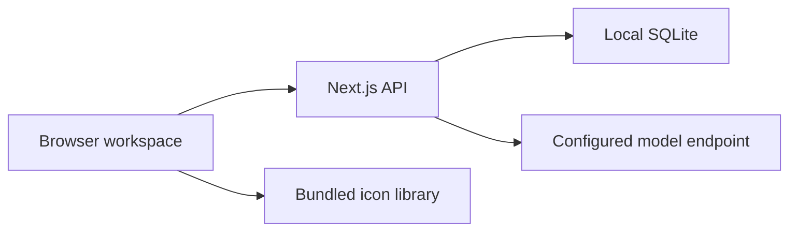

# esdesign · EASY ICON

[简体中文](README.md) | English

## About

EASY ICON is a local AI icon creation and management workspace. Describe an icon in words to generate six SVG styles of the same subject, or browse the built-in library to preview, customize, and download icons for apps, websites, and prototypes.

Generate icons, organize them on a canvas, save projects, manage favorites and the recycle bin, and download multiple formats in one workspace. Project data is stored locally in SQLite. Single-user local mode requires no account or sign-in.

The code and repository-owned icons, images, and documentation are licensed under the [MIT License](LICENSE), permitting use, modification, redistribution, and commercial use with the required notices. Third-party dependencies and referenced assets retain their own licenses; see [Third-party notices](THIRD_PARTY_NOTICES.md).

## Features

- **Text-to-icon generation:** Generate one subject or a batch. Each subject has six SVG styles: Linear, Outline, Bold, Broken, Bulk, and Twotone. The canvas shows one item per subject, using Linear by default.
- **Canvas controls:** Pan, zoom, focus on an icon, arrange groups automatically, and use alignment guides while dragging.
- **Project management:** Create, select, and edit projects; persist generated results, settings, and canvas positions.
- **Favorites and recycle bin:** Manage groups and individual icons separately. Select multiple items to download, remove favorites, restore, or permanently delete.
- **Preview and download:** Switch styles, adjust supported colors and output sizes, and download SVG, PNG, or WebP. Raster output supports sizes up to 1024px.
- **Code export:** Preview and copy SVG, Vue, React, HTML, Svelte, and Web Components code.
- **Icon library:** Browse by category, search by keyword, filter by style, open details, favorite, and download. Library favorites are separate from project favorites.
- **Interface and local data:** Chinese and English UI, light and dark themes, local profile settings, and local persistence without sign-in.

Local mode does not need Docker, Supabase, or an email service. **Generation still calls your configured model endpoint, which may incur charges and is subject to provider quotas.**

## Screenshots

These are actual application screenshots, not mockups. Canvas, favorites, and recycle-bin examples use local demo data. The generated star below comes from a real model request in SQLite local mode. Screenshots currently show the Chinese UI; the application also supports English.

### Generation workspace

Describe icons, manage projects, and organize results on the canvas.



### Six styles and code

Switch between styles of the same subject and export code in six formats.



### Favorites and recycle bin




### Icon library





## Installation

Start with the [detailed installation guide](docs/guides/simple-local.en.md) for Node.js setup, source download, model configuration, your first generation, updates, backups, and troubleshooting.

Requirements: Node.js 24+, npm, and a compatible model endpoint supporting JSON output and image input.

From the repository root:

```bash
npm ci
cp apps/web/.env.example apps/web/.env.local
```

Do not overwrite an existing `.env.local`. On Windows PowerShell, use `Copy-Item` instead of `cp` as described in the installation guide. Configure your endpoint, API key, and actual model IDs, then run:

```bash
npm run dev:local
```

Open [http://127.0.0.1:3000/create](http://127.0.0.1:3000/create). No sign-in is needed. The database is created automatically at `.local/easy-icon/workspace.sqlite`.

For regular use, stop the development server, build, and start:

```bash
npm run build:local
npm run start:local
```

Keep the terminal running. Use `Ctrl+C` to stop the server. Existing Supabase data is neither imported nor deleted automatically.

## Architecture and generation pipeline

The application uses Next.js 16, React 19, and TypeScript. Frontend and API handlers run in `apps/web`; shared validation lives in `packages/shared`. Local mode stores project records and SVG variants in SQLite and serves the icon library from bundled static files.



The generation pipeline parses the request, resolves intent conflicts, plans the subject's structure, draws six styles, checks SVG safety and geometry, renders previews for model-assisted visual review, and saves results with recovery context. A technical pass is not the same as visual acceptance.

The model endpoint may be a compatible provider or an optional sub2api gateway. sub2api is installed and configured separately; it is not started by this project. Sharp and PathKit/WASM are npm dependencies for rendering and outline conversion. Users do not need Codex or the development SVG skill installed.

- [Detailed installation and configuration](docs/guides/simple-local.en.md)
- [Full architecture and pipeline reference — Chinese](docs/open-source-guide.md)
- [Screenshot gallery — Chinese captions](docs/screenshots/README.md)
- [Development principles — Chinese](docs/project/development-principles.md)

## Tests

```bash
npm run typecheck
npm run lint
npm test
node --test scripts/local-commercial-cleanup.test.mjs
node --test scripts/local-database.test.mjs
node scripts/test-simple-local.mjs
```

The last test requires local SQLite mode on port 3000, uses fixture SVGs rather than model calls, and removes only its temporary project. Real generation and visual quality require separate frontend testing.

## Limitations

- `pending` or `rework-required` review status does not mean visual acceptance.
- Provider authorization, model routing, quotas, and timeouts can cause failures; a batch is not guaranteed to succeed on its first attempt.
- Legacy image workers and database migrations remain for compatibility; old paid raster creation is disabled.
- Local mode is single-user and loopback-only. Do not expose it publicly or use it as a multi-user service.
- A clean source snapshot passes 480 tests, type checking, linting, and the local build. Actual Windows/Linux installation and model quality need separate verification. Production dependency auditing reports zero vulnerabilities; development tooling retains an upstream `braces` advisory. See [security verification notes](docs/testing/security-ci-remediation.md).
