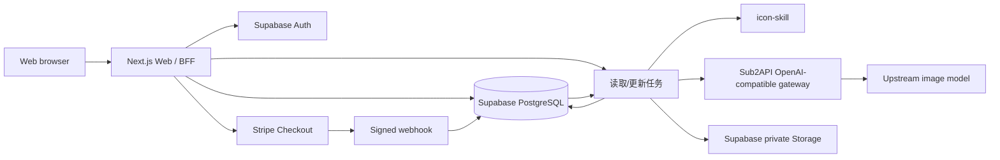

# 后端技术架构

## 1. 目标与范围

后端支持 Bamboo IconGen MVP 的完整业务闭环：登录用户提交多个 UI 图标主体与结构化设计设置，系统扣除点数、为每个主体异步生成 3 个 PNG 方案、派生所选尺寸，并为交互图标和极简标志派生 SVG，私有保存结果和打包 ZIP，同时支持 Stripe 点数包入账及失败退款。

## 2. 总体架构

## 3. 代码模块

- `apps/web`：浏览器页面与 BFF。负责会话校验、任务创建、查询、签名下载 URL、Stripe Checkout 和 Webhook。
- `packages/shared`：前后端共用输入校验、任务状态和生成协议。
- `packages/backend-core`：不依赖供应商 SDK 的领域接口与生成任务用例。
- `packages/icon-skill`：以 imagegen 式结构化流程把版本化 `GenerationSpec` 编译为用途模板、风格规范、共享生产边界和 3 个差异化方案，并记录 Skill 与核心设置版本。
- `services/icon-worker`：与运行平台无关的生成核心及 OpenAI、Supabase 适配器。
- `infra/supabase`：数据库表、RLS、私有文件桶与事务函数。

模型和 Skill 都通过 Worker 注册表选择。`IMAGE_PROVIDER`、`IMAGE_MODEL`、`IMAGE_QUALITY`、`IMAGE_SIZE` 和 `ICON_SKILL` 是服务端配置；母版默认使用 `high` 质量和 `2048x2048` 尺寸。新增供应商只实现 `ImageProvider`，新增 Skill 只实现 `PromptCompiler`，不会影响任务、扣点和存储代码。任务及每个结果都会记录实际使用的 Provider、模型、质量、Skill 名称与版本。

## 4. 核心流程

### 创建生成任务

1. BFF 校验用户会话和描述字段。
2. BFF 使用客户端幂等键调用 `create_generation_job_and_debit`。
3. PostgreSQL 在同一事务中锁定点数账户、扣点、建立任务并写账本。
4. 本地开发环境由 BFF 在创建任务后直接启动 Worker；月付 VPS 测试环境由独立常驻 Worker 消费任务，正式生产执行器在公开上线前重新评估。

### 批量生成每主体 3 个方案

1. 服务端执行器领取一个待处理任务并验证任务状态。
2. Worker 读取任务规格快照，按主体建立 3 个 variant 工作单元；Icon Skill 根据用途与风格加载独立 style spec，再组合共享生产边界和 A/B/C 构图差异。
3. OpenAI-compatible Image2 Provider 通过同机独立服务 Sub2API 调用上游模型并生成高分辨率 PNG；非付费质量门禁检查母版尺寸、方形画布和 App 图标明显深色外底并记录结构化告警，然后派生 512px 预览、用户选择的 PNG 正式尺寸，并为受支持任务本地派生 SVG，保存至私有 Storage。
4. 任务进度由完成或最终失败的工作单元计算；全部处理结束后进入 `completed`、`partial` 或 `failed`。
5. 临时错误只重试未成功工作单元；最终失败按版本化规则原子返还点数。
6. 用户提交选中的 variant 后，服务端校验所有权并打包每个方案的原图与全部交付尺寸；支持 SVG 的风格可通过复选框选择是否追加 SVG。

### Stripe 入账

1. BFF 使用用户幂等键创建待支付订单，由后端生成 `ICO-YYYYMMDD-XXXXXXXXXX` 业务订单号并固化套餐、价格版本、金额、币种和点数快照，再创建 Stripe Checkout Session。
2. 浏览器跳转成功页只展示状态，不直接增加点数。
3. Webhook 验证 Stripe 签名，并核对 metadata 中的内部订单 UUID、金额和币种后调用 `credit_paid_order`。
4. `stripe_events` 以 Stripe Event ID 去重，订单行加锁；订单更新、点数增加与账本记录在同一事务完成。

### 作品清理与账户数据导出

1. 作品从生成完成时间起保留 30 天，定时清理任务删除母版、派生 PNG、预览文件和关联临时归档。
2. 用户提交账户删除后进入 30 天 `deletion_pending` 宽限期，只允许账户、历史、导出和撤销删除相关操作。
3. 数据导出任务读取账户资料、订单、完整点数账本并计算账单摘要，同时查询请求时仍有效的作品资产，生成包含结构化 JSON/CSV、PNG 和 `manifest.json` 的私有 ZIP。
4. 导出 ZIP 保存 24 小时并通过短时签名 URL 下载；过期后可在账户宽限期内重新申请。
5. 账户正式删除前等待进行中的导出完成或达到超时；导出不会延长任何作品的原始保留期限。
6. 清理、导出和账户删除均使用幂等键，并记录不包含敏感内容的审计事件。

## 5. 数据与安全

- 所有用户数据表开启 RLS，用户仅能读取自己的资料、余额、订单、任务和结果。
- 浏览器不得持有 OpenAI、Stripe Secret 或 Supabase Service Role 凭据。
- Worker 仅使用服务端密钥；生成文件桶不公开，下载使用短期签名 URL。
- 个人数据导出桶保持私有；订单只导出非敏感支付引用和金额状态，不得包含模型 API Key、完整内部 Prompt、支付卡数据、Stripe 密钥、管理员备注或管理审计详情。
- `credit_ledger` 是不可变账本，余额是高效读取的账户快照。
- 管理操作写入 `admin_audit_logs`；管理权限后续通过 JWT Claim/RBAC 扩展。
- 日志只记录任务 ID、阶段、耗时和错误码，不记录密钥、完整提示词或付款信息。

## 6. 可靠性与成本控制

- 父任务拆分为主体 × 3 的幂等工作单元；后台执行器必须限制并发，避免模型 API 突发费用。
- variant 表以 `(subject_id, slot)` 唯一，文件路径包含 `{jobId}/{subjectId}/variant-{slot}/{size}.png`，重试可安全跳过已成功资产。
- 后续应加入“已完成 slot 跳过生成”和 queued 任务恢复机制，进一步降低重复生成成本。

## 7. 环境与部署

- 本地开发：Web BFF 可以直接启动 Worker，使用 mock 或受控真实模型完成联调。
- 短期测试：东京区域月付 4 GB VPS 合并运行 Caddy、生产构建的 Next.js Web/BFF、独立常驻 Worker、Sub2API及其专用PostgreSQL/Redis；配置2–4 GB swap，Worker和图片网关并发均为1，默认只开放每批1–3个主体。
- 模型网关：Bamboo Worker通过私有容器网络、专用限额API Key和内部 `IMAGE_PROVIDER_BASE_URL` 调用同机Sub2API；Sub2API API、PostgreSQL和Redis不暴露公网。
- 数据：业务数据继续使用Supabase Auth、PostgreSQL和私有Storage；VPS上的PostgreSQL只供Sub2API使用。Supabase项目区域尽量靠近VPS与主要测试用户，避免不必要的跨洲链路。
- 正式生产候选：Vercel 承载 Web，生产 Worker 独立部署；公开上线前根据测试数据重新评估执行平台、队列、高可用和数据区域。
- 监控：短期测试至少采集主机 CPU/内存/磁盘、Web/Worker 日志、成功率、P95 耗时和模型费用；正式生产再接入 Vercel Logs、Supabase Logs、Sentry 或等效服务。

短期测试的完整拓扑、资源限制、安全要求和验收清单见 [月付 VPS 测试部署指南](../guides/monthly-vps-test-deployment.md)，冻结决策见 [ADR-0004](../decisions/0004-monthly-vps-test-deployment.md)。

## 8. 后端环境变量

Worker 变量见 `services/icon-worker/.env.example`。本地默认使用 `IMAGE_PROVIDER=mock`，不需要模型 API Key；真实生成切换为 `IMAGE_PROVIDER=openai`，并配置指向 Sub2API `/v1` 的 `IMAGE_PROVIDER_BASE_URL` 及 Bamboo 专用网关 API Key。`IMAGE_QUALITY` 默认设为 `high`，`IMAGE_SIZE` 默认设为 `2048x2048`，OpenAI-compatible Provider 会将二者作为接口参数显式传入。Web BFF 需要 Supabase URL/Anon Key/Service Role 和 Stripe Secret/Webhook Secret；所有生产密钥只保存在服务端安全环境变量中。

## 9. 当前实现边界

共享 v2 Schema、版本化图标设计风格配置及批量数据库迁移已经建立。MVP 不支持完整 266 项或高级模式。Worker 已切换到 subjects × 3 variants，能够从高清母版生成 PNG 交付尺寸：普通风格使用 Lanczos3 并对 64/128/256 做克制锐化，像素艺术使用最近邻缩放；PNG 保持无损和透明通道。任务汇总、本地真实模型、进度查询和下载接口链路已贯通。生产部署仍需配置服务端密钥与执行器；具体状态以开发计划和需求一致性审计为准。
