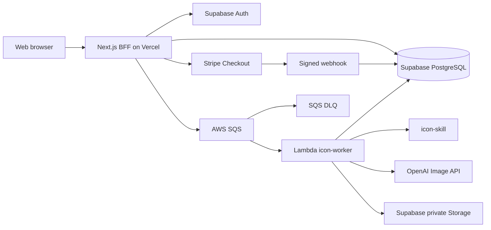

# 后端技术架构

## 1. 目标与范围

后端支持 IconGen MVP 的完整业务闭环：登录用户提交一段英文描述，系统扣除点数、异步生成 4 个 PNG 方案、私有保存结果，并支持 Stripe 点数包入账及失败退款。

## 2. 总体架构

## 3. 代码模块

- `apps/web`：浏览器页面与 BFF。负责会话校验、任务创建、查询、签名下载 URL、Stripe Checkout 和 Webhook。
- `packages/shared`：前后端共用输入校验、任务状态和 SQS 消息协议。
- `packages/backend-core`：不依赖供应商 SDK 的领域接口与生成任务用例。
- `packages/icon-skill`：把产品描述编译为 4 个差异化的图标生成提示词，并记录 Skill 版本。
- `services/icon-worker`：SQS Lambda 入口及 OpenAI、Supabase 适配器。
- `infra/supabase`：数据库表、RLS、私有文件桶与事务函数。
- `infra/aws`：SQS、DLQ、Lambda 和 CloudWatch 告警。

## 4. 核心流程

### 创建生成任务

1. BFF 校验用户会话和描述字段。
2. BFF 使用客户端幂等键调用 `create_generation_job_and_debit`。
3. PostgreSQL 在同一事务中锁定点数账户、扣点、建立任务并写账本。
4. BFF 将版本化消息 `{ version, jobId, requestedAt }` 发送到 SQS。
5. 若发送暂时失败，BFF 可用相同幂等键重试；后台补偿任务可重新投递仍处于 `queued` 的任务。

### 生成 4 个方案

1. Lambda 消费一个 SQS 消息并验证协议。
2. Worker 领取任务，Icon Skill 生成四个方向明确不同的提示词。
3. OpenAI Provider 按方案生成 PNG，保存至私有 Storage，并逐个写入结果记录。
4. 只有 4 个结果都存在时，数据库才允许任务进入 `completed`。
5. 临时错误由 SQS 重试；达到最大次数后任务进入 `failed` 并原子返还点数。

### Stripe 入账

1. BFF 创建待支付订单和 Stripe Checkout Session。
2. 浏览器跳转成功页只展示状态，不直接增加点数。
3. Webhook 验证 Stripe 签名后调用 `credit_paid_order`。
4. `stripe_events` 以 Stripe Event ID 去重，订单更新、点数增加与账本记录在同一事务完成。

## 5. 数据与安全

- 所有用户数据表开启 RLS，用户仅能读取自己的资料、余额、订单、任务和结果。
- 浏览器不得持有 OpenAI、Stripe Secret、Supabase Service Role 或 AWS 凭据。
- Worker 仅使用服务端密钥；生成文件桶不公开，下载使用短期签名 URL。
- `credit_ledger` 是不可变账本，余额是高效读取的账户快照。
- 管理操作写入 `admin_audit_logs`；管理权限后续通过 JWT Claim/RBAC 扩展。
- 日志只记录任务 ID、阶段、耗时和错误码，不记录密钥、完整提示词或付款信息。

## 6. 可靠性与成本控制

- SQS 可见性超时必须大于 Lambda 超时；当前分别为 960 秒和 900 秒。
- 单条消息处理一个任务，Lambda 预留并发默认 5，避免模型 API 突发费用。
- 最多消费 3 次后进入 DLQ，并通过 CloudWatch Alarm 报警。
- 结果表以 `(job_id, slot)` 唯一，文件路径固定为 `{jobId}/result-{slot}.png`，重试可安全覆盖。
- 后续应加入“已完成 slot 跳过生成”和 queued 任务补偿投递，进一步降低重复生成成本。

## 7. 环境与部署

- Web：Vercel，生产域名和 Edge/CDN 面向海外用户。
- 数据：Supabase 项目优先选择美国东部区域。
- Worker：AWS Lambda + SQS，优先 `us-east-1`，减少跨区延迟。
- 监控：Vercel Logs、CloudWatch、Sentry；关键指标包括成功率、P95 耗时、每任务模型成本、退款率和 DLQ 数量。

## 8. 后端环境变量

Worker 变量见 `services/icon-worker/.env.example`。Web BFF 需要 Supabase URL/Anon Key/Service Role、Stripe Secret/Webhook Secret、AWS 区域及生成队列 URL；所有生产密钥只保存在部署平台的加密环境变量或 Secrets Manager。

## 9. 当前实现边界

本次完成后端基础架构、领域用例、Worker、数据库迁移与云模板。Web 侧任务 API、Stripe Checkout/Webhook 的具体 Route Handler 仍需在对应业务模块开发时接入这些事务函数与队列。

