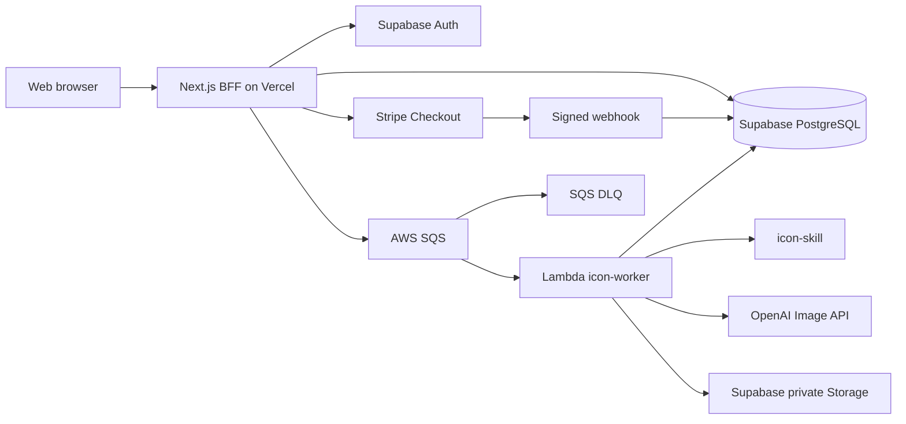

# 后端技术架构

## 1. 目标与范围

后端支持 Bamboo IconGen MVP 的完整业务闭环：登录用户提交多个 UI 图标主体与结构化设计设置，系统扣除点数、为每个主体异步生成 3 个 PNG 方案、派生所选尺寸、私有保存结果和打包 ZIP，并支持 Stripe 点数包入账及失败退款。

## 2. 总体架构

## 3. 代码模块

- `apps/web`：浏览器页面与 BFF。负责会话校验、任务创建、查询、签名下载 URL、Stripe Checkout 和 Webhook。
- `packages/shared`：前后端共用输入校验、任务状态和 SQS 消息协议。
- `packages/backend-core`：不依赖供应商 SDK 的领域接口与生成任务用例。
- `packages/icon-skill`：把版本化 `GenerationSpec` 按主体编译为 3 个差异化提示词，并记录 Skill 与核心设置版本。
- `services/icon-worker`：SQS Lambda 入口及 OpenAI、Supabase 适配器。
- `infra/supabase`：数据库表、RLS、私有文件桶与事务函数。
- `infra/aws`：SQS、DLQ、Lambda 和 CloudWatch 告警。

模型和 Skill 都通过 Worker 注册表选择。`IMAGE_PROVIDER`、`IMAGE_MODEL`、`IMAGE_QUALITY` 和 `ICON_SKILL` 是部署配置；首发质量固定为 `medium`。新增供应商只实现 `ImageProvider`，新增 Skill 只实现 `PromptCompiler`，不会影响任务、扣点、队列和存储代码。任务及每个结果都会记录实际使用的 Provider、模型、质量、Skill 名称与版本。

## 4. 核心流程

### 创建生成任务

1. BFF 校验用户会话和描述字段。
2. BFF 使用客户端幂等键调用 `create_generation_job_and_debit`。
3. PostgreSQL 在同一事务中锁定点数账户、扣点、建立任务并写账本。
4. BFF 将版本化消息 `{ version, jobId, requestedAt }` 发送到 SQS。
5. 若发送暂时失败，BFF 可用相同幂等键重试；后台补偿任务可重新投递仍处于 `queued` 的任务。

### 批量生成每主体 3 个方案

1. Lambda 消费一个 SQS 消息并验证协议。
2. Worker 读取任务规格快照，按主体建立 3 个 variant 工作单元；Icon Skill 为每个工作单元编译提示词。
3. OpenAI Provider 生成高分辨率 PNG，后处理为用户选择的尺寸，保存至私有 Storage，并逐个写入 variant 与 asset 记录。
4. 任务进度由完成或最终失败的工作单元计算；全部处理结束后进入 `completed`、`partial` 或 `failed`。
5. 临时错误只重试未成功工作单元；最终失败按版本化规则原子返还点数。
6. 用户提交选中的 variant 和尺寸后，服务端校验所有权并建立短时 ZIP 下载归档。

### Stripe 入账

1. BFF 使用用户幂等键创建待支付订单，由后端生成 `ICO-YYYYMMDD-XXXXXXXXXX` 业务订单号并固化套餐、价格版本、金额、币种和点数快照，再创建 Stripe Checkout Session。
2. 浏览器跳转成功页只展示状态，不直接增加点数。
3. Webhook 验证 Stripe 签名，并核对 metadata 中的内部订单 UUID、金额和币种后调用 `credit_paid_order`。
4. `stripe_events` 以 Stripe Event ID 去重，订单行加锁；订单更新、点数增加与账本记录在同一事务完成。

### 作品清理与账户数据导出

1. 作品从生成完成时间起保留 30 天，定时清理任务删除母版、派生 PNG、预览文件和关联临时归档。
2. 用户提交账户删除后进入 30 天 `deletion_pending` 宽限期，只允许账户、历史、导出和撤销删除相关操作。
3. 数据导出任务读取账户资料、订单、完整点数账本并计算账单摘要，同时查询请求时仍有效的作品资产，生成包含结构化 JSON/CSV、PNG 和 `manifest.json` 的私有 ZIP。
4. 导出 ZIP 保存 24 小时并通过短时签名 URL 下载；过期后可在账户宽限期内重新申请。
5. 账户正式删除前等待进行中的导出完成或达到超时；导出不会延长任何作品的原始保留期限。
6. 清理、导出和账户删除均使用幂等键，并记录不包含敏感内容的审计事件。

## 5. 数据与安全

- 所有用户数据表开启 RLS，用户仅能读取自己的资料、余额、订单、任务和结果。
- 浏览器不得持有 OpenAI、Stripe Secret、Supabase Service Role 或 AWS 凭据。
- Worker 仅使用服务端密钥；生成文件桶不公开，下载使用短期签名 URL。
- 个人数据导出桶保持私有；订单只导出非敏感支付引用和金额状态，不得包含模型 API Key、完整内部 Prompt、支付卡数据、Stripe 密钥、管理员备注或管理审计详情。
- `credit_ledger` 是不可变账本，余额是高效读取的账户快照。
- 管理操作写入 `admin_audit_logs`；管理权限后续通过 JWT Claim/RBAC 扩展。
- 日志只记录任务 ID、阶段、耗时和错误码，不记录密钥、完整提示词或付款信息。

## 6. 可靠性与成本控制

- SQS 可见性超时必须大于 Lambda 超时；当前分别为 960 秒和 900 秒。
- 父任务拆分为主体 × 3 的幂等工作单元；Lambda 预留并发默认 5，避免模型 API 突发费用。
- 最多消费 3 次后进入 DLQ，并通过 CloudWatch Alarm 报警。
- variant 表以 `(subject_id, slot)` 唯一，文件路径包含 `{jobId}/{subjectId}/variant-{slot}/{size}.png`，重试可安全跳过已成功资产。
- 后续应加入“已完成 slot 跳过生成”和 queued 任务补偿投递，进一步降低重复生成成本。

## 7. 环境与部署

- Web：Vercel，生产域名和 Edge/CDN 面向海外用户。
- 数据：Supabase 项目优先选择美国东部区域。
- Worker：AWS Lambda + SQS，优先 `us-east-1`，减少跨区延迟。
- 监控：Vercel Logs、CloudWatch、Sentry；关键指标包括成功率、P95 耗时、每任务模型成本、退款率和 DLQ 数量。

## 8. 后端环境变量

Worker 变量见 `services/icon-worker/.env.example`。本地默认使用 `IMAGE_PROVIDER=mock`，不需要模型 API Key；真实生成切换为 `IMAGE_PROVIDER=openai` 后必须由平台方配置 API Key。`IMAGE_QUALITY` 默认并固定为 `medium`，OpenAI Provider 会显式传入该值。Web BFF 需要 Supabase URL/Anon Key/Service Role、Stripe Secret/Webhook Secret、AWS 区域及生成队列 URL；所有生产密钥只保存在部署平台的加密环境变量或 Secrets Manager。

## 9. 当前实现边界

共享 v2 Schema、6 组 25 个核心设置及批量数据库迁移已经建立。MVP 不支持完整 266 项或高级模式。Worker 已切换到 subjects × 3 variants，能够真实缩放 PNG、汇总主体与任务状态，并对未完整交付的主体按 1 点退款。真实模型、SQS、进度查询和下载接口仍需完成部署联调；具体状态以开发计划和需求一致性审计为准。
