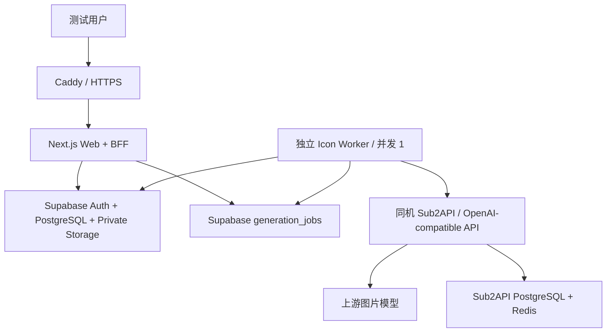

# 月付 VPS 测试部署指南

本文定义 Bamboo IconGen 短期测试环境的部署目标、拓扑、资源限制和验收条件。它不是正式生产环境的高可用设计。

购买入口、服务器初始化、DNS、Docker、Caddy、Supabase、启动、备份和验收的逐步命令见[单台4 GB VPS合并部署操作手册](./single-vps-deployment-runbook.md)。

## 1. 测试目标

- 验证中国大陆电信、联通、移动以及主要海外地区的实际访问表现。
- 控制图片模型突发费用，避免测试流量绕过点数、并发和速率限制。

## 2. 基线拓扑

单台 VPS 合并运行 Bamboo 与 Sub2API。业务数据库、认证和图片资产继续使用 Supabase，以保持现有 RLS、事务函数、账户体系和私有 Storage 不变；VPS 中的 PostgreSQL 和 Redis只供 Sub2API 使用。Supabase 业务数据库与 Sub2API 数据库用途不同，不得混用。

## 3. 资源基线

| 项目 | 测试基线 |
| --- | --- |
| 区域 | 东京优先；购买前使用测试 IP 验证大陆三网 |
| CPU | 2 vCPU |
| 内存 | 4 GB RAM |
| 磁盘 | 约 80 GB SSD |
| Swap | 2–4 GB，只作为峰值保护，不能替代扩容 |
| Worker 并发 | 全局 1 |
| 单批运营限制 | 默认 1–3 个主体 |
| 数据库与资产 | Supabase 测试项目和私有 Bucket |
| 模型网关 | 同机 Sub2API；使用专用 PostgreSQL 和 Redis |

4 GB 是合并部署的最低测试基线。Next.js 构建、Sharp 原始像素缓冲、服务端 ZIP、Sub2API、PostgreSQL 和 Redis 可能同时制造内存峰值。必须限制并发并下调 Sub2API 默认资源参数；出现 swap 持续使用、OOM、ZIP 失败或 Web 延迟时，升级到至少 8 GB 或拆分 Sub2API/Worker。

建议的4 GB测试参数起点：PostgreSQL `shared_buffers=256MB`、`effective_cache_size=1536MB`、`maintenance_work_mem=64MB`、最大连接数 100；Sub2API数据库最大打开连接 20–30、空闲连接5–10；Redis连接池32–64；Bamboo Worker和Sub2API图片并发均为1。上线后依据监控调整，不照搬现有面向大内存环境的参数。

## 4. 进程与网络

建议使用 Docker Compose 或 systemd 管理以下独立进程：

1. `web`：以生产模式运行 Next.js，监听本机应用端口。
2. `worker`：常驻领取 Supabase 中的 `queued` 任务，处理后更新任务状态。
3. `sub2api`：仅在私有容器网络提供 OpenAI-compatible API。
4. `sub2api-postgres`：只供 Sub2API 使用的持久化数据库。
5. `sub2api-redis`：只供 Sub2API 使用的缓存和调度组件。
6. `caddy`：终止 TLS 并反向代理到 Web；Sub2API管理入口如需开放，使用独立子域名并增加访问控制。

网络要求：

- 公网只开放 80/443；22 仅允许密钥登录并尽量限制管理来源。
- Sub2API PostgreSQL和Redis只加入私有容器网络，不映射宿主机或公网端口。
- Worker设置内部 `IMAGE_PROVIDER_BASE_URL=http://sub2api:8080/v1`；`IMAGE_PROVIDER_API_KEY` 使用为Bamboo单独创建、可撤销且限额的网关Key。内部地址不得发送给浏览器。
- Sub2API 的管理界面不直接暴露给公众，优先使用 IP 白名单、VPN 或独立身份验证保护；其 PostgreSQL 和 Redis 仅在容器内部网络开放。
- 日志不得记录完整 Prompt、用户令牌、服务密钥或支付敏感信息。

## 5. Worker 生产执行器缺口

当前 `startLocalGenerationJob` 在 `NODE_ENV=production` 时直接返回，因此仅运行 `npm run build && npm run start` 不会消费生成任务。部署前必须实现或接入独立生产 Worker，至少满足：

- 原子领取一个 `queued` 任务，避免重复消费；
- 全局并发为 1，并保留单用户活动任务限制；
- 进程重启后能够恢复遗留的 `queued/processing` 任务；
- 重试跳过已成功 variant，避免重复模型费用；
- 支持优雅退出、错误日志、健康检查和失败告警。

在该缺口关闭前，环境只能验证 Web、认证和模拟数据，不能称为完整生成测试环境。

## 6. 数据、区域与隐私

- Supabase 区域尽量靠近东京 VPS 和主要用户；避免 Web、数据库和 Storage 形成跨洲链路。
- 测试优先使用虚构账户与非敏感数据。
- 测试 Bucket 保持私有，下载只使用短期签名 URL；设置测试资产清理策略。
- 生成 Prompt 会经过 Sub2API 和上游模型。不得在 Prompt 中加入邮箱、手机号、用户令牌或其他无关个人信息；隐私政策和供应商清单应覆盖该处理链路。

## 7. 成本控制

- VPS使用按小时累计、月费封顶的4 GB套餐；参考Lightsail同档约USD 24/月。停机通常仍计费，结束测试时删除实例及关联静态IP、快照和存储。
- OpenAI 图片费用可能远高于 VPS。真实生成前配置预算告警、点数上限、全局并发 1 和受邀账户白名单。
- Sub2API 同时配置 Bamboo 专用 API Key、额度、速率/并发限制和调用日志脱敏；网关限额不能替代 Bamboo 自身的点数与幂等控制。
- 域名通常按年购买；纯内部测试可先使用临时域名，涉及认证回调、邮件链接和 Cookie 验证时再使用正式域名。

## 8. 上线验收清单

- [ ] Web 使用生产构建运行，HTTPS、重定向和安全响应头正常。
- [ ] Supabase Site URL、Redirect URLs、RLS 和私有 Bucket 已按测试域名配置。
- [ ] Worker 独立运行，生产环境可以领取任务，且并发不超过 1。
- [ ] Worker通过私有容器网络调用Sub2API `/v1/images/generations`；网关返回 `data[0].b64_json`，超时和错误码可追踪。
- [ ] Sub2API PostgreSQL/Redis 未暴露公网，管理入口受保护，Bamboo 使用独立限额 API Key。
- [ ] 进程重启后任务可恢复，不重复扣点或重复生成已完成 variant。
- [ ] 1–3 个主体的生成、进度、单图和 ZIP 下载闭环通过。
- [ ] 模拟 Worker 异常、Sub2API/上游模型超时和主机重启，确认任务进入可解释状态并按规则重试/返点。
- [ ] 大陆电信、联通、移动和至少一个海外网络完成首页、登录、生成和下载测试。
- [ ] 配置 CPU、内存、磁盘、错误率和模型费用告警。
- [ ] 真实用户测试所需的隐私说明、删除入口和支持邮箱已就绪。

## 9. 退出与升级

测试结束时导出需要保留的日志和非敏感配置，确认 Supabase 数据/资产的保留或删除策略，然后删除 VPS 及其附属付费资源。

如果测试继续扩大，优先升级到至少8 GB或将Sub2API/Worker拆到独立节点；正式上线则重新评估Web托管、Worker队列、高可用、定时清理、监控、数据区域和合规要求。
