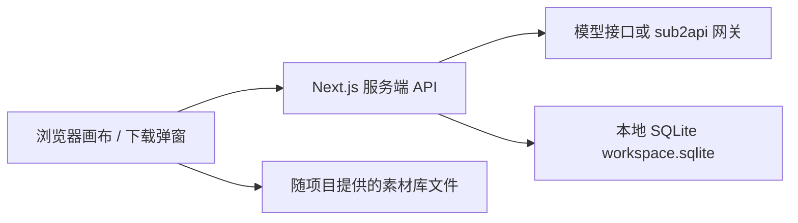
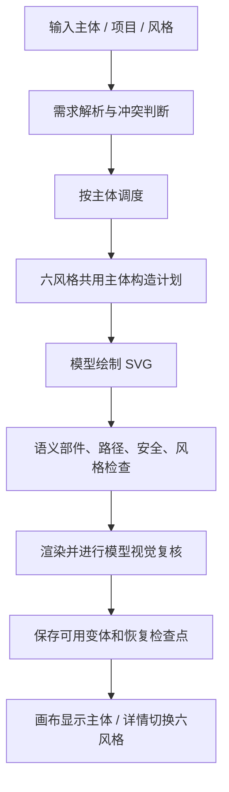

# esdesign 开源准备与技术说明

EASY ICON 是一个本地运行的 AI 图标创作工作台。输入文字描述，即可为每个主体生成六种风格的 SVG 图标，并在画布中预览、整理和管理。

## 主要功能

- **AI 图标生成**：支持单个主体或批量生成，每个主体提供 Linear、Outline、Bold、Broken、Bulk、Twotone 六种风格。
- **画布编辑**：支持平移、缩放、图标聚焦、拖动对齐和自动整理。
- **项目管理**：创建、关联和编辑项目，保存生成结果及画布位置。
- **收藏与回收**：分别管理图组和单图，支持多选操作、恢复和永久删除。
- **预览与下载**：切换六种风格，查看和复制代码，设置颜色与尺寸，下载 SVG、PNG 或 WebP。
- **素材库**：按分类、关键词和风格查找图标，预览详情、收藏和下载。
- **界面设置**：支持中英文及深浅主题切换。
- **本地部署**：单用户免登录，使用 SQLite 保存数据，无需 Supabase 或 Docker；生成时调用自行配置的模型接口。

## 架构

当前推荐 `npm run dev:local`：单用户 + SQLite，无需 Docker / Supabase / Mailpit。旧 Supabase 路径保留兼容，不是简化模式的运行依赖；详见[简化部署说明](guides/simple-local.md)。



| 目录 | 职责 |
| --- | --- |
| apps/web | Next.js 16、React 19、TypeScript，前端和服务端 API、SVG 检查与导出 |
| packages/shared | 共享类型、Schema 和约束 |
| packages/icon-skill | 历史图片提示词与技能版本，不是当前 SVG 链路全部实现 |
| packages/backend-core、services/icon-worker | 历史异步图片任务，当前 SVG 默认不需要独立 Worker |
| infra/supabase/migrations | 数据结构、RLS、项目与 SVG 数据的顺序迁移 |
| apps/web/public/library/samples | 素材库示例与构造参考，发布前需要授权审计 |
| .local/supabase | 私密运行配置、数据库目录和环境备份，禁止提交 |

数据关系：icon_projects 保存项目；project_svg_icon_sets 保存需求计划、设置快照、坐标、收藏和回收状态；project_svg_icons 保存主体 SVG、style_variants 六风格数据与生成上下文。单图通过所属图组关联项目，不属于素材库收藏。简化模式使用一个固定本地用户；只绑定回环地址，并检查 Host 和写请求 Origin，不可公网暴露。旧 Supabase 模式才使用 RLS 与远程认证。

## 生成链路



关键代码位于 apps/web/src/features/generation，以下 server 路径均相对于此目录：

| 环节 | 代码 |
| --- | --- |
| 需求解析 | server/plan-icons.ts |
| SVG 入口 | server/generate-svg-icon.ts |
| 六风格计划和会话 | server/library-six-plan.ts、library-six-session.ts |
| 已生成提示词协议 | server/library-protocol.generated.json |
| 构造参考 | server/library-construction-reference.ts、style-reference-board.ts |
| 检查和渲染 | server/library-six-render.ts、validate-generated-svg.ts |
| Outline 轮廓编译 | server/library-outline-geometry.ts（PathKit/WASM） |
| 批次与退避 | generation-batch.ts |
| 保存 | apps/web/src/app/api/projects/[projectId]/svg-sets |

当前协议为 library-six-session-7。运行时读取仓库内协议与示例，不需要访问作者电脑上的 SVG Skill。模型流程不等同于人工 Skill 绘图，不保证审美达到素材库标准。

有效兄弟风格尽量保留；重试带上已保存结果与签名检查点。冷批次先探测一个主体，健康后最多两个调度线程，服务端单进程容量两个。429/5xx 有有限退避重试，400/401/403/404 不无限重试。跨实例持久队列尚未实现。

需求解析默认预算 75 秒；六风格会话总预算 360 秒，计划 120 秒、整组绘制 170 秒、视觉复核 65 秒。不是耗时承诺。复核不可用时可以返回技术可用 SVG，但标记 pending；“继续复核”不能视为视觉通过。描述写“六种风格”仍可能触发旧意图确认，是已观察到的待修复项。

## 功能描述

- 项目：新建、关联、编辑名称/简介、主题设置、图组和主体保存。
- 画布：默认最多每行五列；平移缩放、单图聚焦、自动整理和辅助对齐。
- 风格：Linear / Outline / Bold / Broken / Bulk / Two Tone；代表图默认线性，详情展示六风格。
- 下载：SVG、PNG、WebP，最高 1024px 栅格尺寸；SVG 自身可缩放。代码支持 SVG、Vue、React、HTML、Svelte、Web Components。
- 收藏：整组/单图分类，支持多选下载和取消收藏，定位到画布；与素材库分离。
- 回收：整组/单图、多选恢复/永久删除，恢复后定位；收藏与回收互斥。永久删除不可恢复，必须确认。
- 中英文与深浅主题；单色详情支持颜色调整。

## 工具及配置

| 工具 | 是否必需 | 用途 |
| --- | --- | --- |
| Node.js 24+、npm、Git | 是 | 安装、开发、构建及内置 SQLite |
| Docker Compose | 旧兼容模式需要 | 简化本地模式不需要 |
| Supabase Auth / PostgreSQL / REST / Storage | 仅旧兼容模式 | 简化模式用 SQLite 及静态素材文件 |
| Mailpit | 仅旧兼容模式 | 简化模式没有邮箱注册验证 |
| 兼容模型服务 | 生成需要 | Chat Completions、JSON 输出和图片输入 |
| sub2api | 可选 | 模型网关；不是项目强制依赖 |
| Sharp、PathKit/WASM | 是 | npm 依赖，渲染和轮廓编译 |
| Codex / SVG Skill | 开发可选 | 用户运行网站不需要安装 |
| ffmpeg | 可选 | 仅录屏剪辑 |

模型列在 /models 不等于能调用。要验证实际请求、账户授权、额度、分组和映射。自行确认模型服务商许可；本文不保证所有账户均能调用示例模型。

### 网站环境变量

配置文件 apps/web/.env.local，不提交真实值。

简化模式仅需模型配置；Supabase 和注册相关变量只适用于旧兼容模式。`npm run dev:local` / `build:local` / `start:local` 自动设置本地模式，可选 `EASY_ICON_DATA_DIR` 指定私有数据目录。

| 变量 | 用途 |
| --- | --- |
| IMAGE_PROVIDER_BASE_URL | 模型 API 根路径，例如 http://127.0.0.1:8081/v1 |
| IMAGE_PROVIDER_API_KEY | 服务端模型密钥 |
| ICON_PLANNER_MODEL | 解析模型实际 ID |
| ICON_SVG_MODEL | 构造、绘制、视觉复核模型实际 ID，需支持图片输入 |
| NEXT_PUBLIC_SUPABASE_URL | 本地网关 http://127.0.0.1:18000 |
| NEXT_PUBLIC_SUPABASE_ANON_KEY | 本地公开角色 Key，访问保护依赖 RLS |
| SUPABASE_SERVICE_ROLE_KEY | 高权限服务端 Key，禁止放入 NEXT_PUBLIC 变量 |
| NEXT_PUBLIC_APP_URL | http://127.0.0.1:3000 |
| APP_ENV、NEXT_PUBLIC_APP_ENV、SUPABASE_ENVIRONMENT | 本地统一 development |
| PUBLIC_SIGNUP_ENABLED | 本地注册开关，仍须验证邮件 |
| SUPABASE_ICON_BUCKET | 默认 generated-icons |
| LOCAL_GENERATION_WORKER_ENABLED | 默认 false，SVG 不需旧图片 Worker |
| ICON_REPOSITORY_ROOT | 可选，特殊运行目录时指定本仓库绝对路径 |

dev 启动器读取网站环境和存在的旧 Worker 环境，注意避免历史配置混用。修改配置后重启；生产环境 NEXT_PUBLIC 值改变后需重新构建。

## 旧 Supabase 部署（兼容路径，简化模式无需执行）

### 1. 安装和配置模型

```bash
npm ci
cp apps/web/.env.example apps/web/.env.local
```

填写模型 URL、密钥和可调用模型 ID，不能直接使用占位的 your-model-id。

### 2. 准备官方固定版本服务

```bash
git clone --depth 1 --branch self-hosted/v0.8.2 https://github.com/supabase/supabase.git .local/supabase-source
node scripts/setup-local-supabase.mjs .local/supabase-source/docker
cd .local/supabase
docker compose -f compose.yml up -d
docker compose -f compose.yml ps
cd ../..
```

已验证源版本 self-hosted/v0.8.2，提交 564eab8ad7840b13324f68b1bfac074ef8d51c21。启用 db、auth、rest、storage、imgproxy、meta、studio、api-gw、mailpit，共9个服务；建议 Docker 有至少4GB可用内存，本次分配约8GB，其他容器也共享资源。

脚本生成独立随机密钥和 easy-icon-local 项目，不修改其他容器。所有公开端口仅绑定127.0.0.1。Storage 使用命名卷，避免 macOS bind mount 不支持扩展属性引发上传500。

### 3. 初始化业务结构（仅新数据库）

```bash
node scripts/build-supabase-bootstrap.mjs
cd .local/supabase
docker compose -f compose.yml exec -T db psql -U postgres -d postgres -v ON_ERROR_STOP=1 < ../../infra/supabase/easy-design-bootstrap.sql
cd ../..
node scripts/setup-local-supabase.mjs --connect-web
npm run dev
```

已使用的数据库不能重复导入 bootstrap。原安装到0047的实例只执行新增0048迁移，先备份。0048停止赠点并撤销财务RPC，不删除历史账本。

### 4. 登录与验证

打开 http://127.0.0.1:3000/create ，创建本地账户，在 http://127.0.0.1:18025 查看验证邮件并验证，再登录。云端旧账户不会自动迁移。Google/GitHub OAuth 默认未配置，仅使用邮箱。

### 5. 重启、备份和公网边界

```bash
cd .local/supabase
docker compose -f compose.yml stop
docker compose -f compose.yml up -d
```

停止不删数据。不要执行 down -v、reset 脚本或删除数据库目录。备份包括 PostgreSQL、Storage 卷、配置与密钥；数据库备份不含实际文件，运行中不能简单复制数据目录代替一致性备份。

Studio 网关有密码保护，私密值在 .local/supabase/.env，不要放进公开文档。当前开发网站只监听127.0.0.1，公网部署不在此次验收范围，需要反向代理、HTTPS、真实SMTP、网络隔离和备份方案。

## 测试和排障

简化模式优先执行 `node --test scripts/local-database.test.mjs` 和 `node scripts/test-simple-local.mjs`：覆盖数据库事务、跨进程持久化、项目、六风格保存、收藏、回收恢复与同源保护。以下邮箱/Storage 测试仅用于旧 Supabase 模式。

```bash
npm run typecheck
npm run lint
npm test
node --env-file=apps/web/.env.local scripts/test-local-deployment.mjs
```

本地冒烟覆盖注册、验证邮件、登录/cookie、生成页跳转、账户、项目读写、私有文件上传下载；仅接受本地地址，清理自身测试账户和文件，不调用模型。前端生成质量、保存恢复、六风格完整性和导出需另行真实验收。

| 症状 | 排查方向 |
| --- | --- |
| 登录402 | 网站仍指向旧云端数据库，重查环境并重启 |
| 文件系统扩展属性错误 | Storage 是否误用 macOS bind mount |
| 模型配置无效 | 上游400/401/403/404、授权和模型映射 |
| 429/无可调度账号 | 额度、账号过期日期、调度和分组 |
| partId缺失 | 构造计划和技术检查，不是数据库故障 |
| 继续复核 | 视觉复核未完成或仍需修订 |
| 服务重启后配置丢失 | 用项目 dev 启动器并持久保存模型设置 |

## 开源发布注意事项

代码及仓库自有素材采用根目录 MIT License，第三方依赖和引用资产保留各自许可证，参见 THIRD_PARTY_NOTICES.md。当前本地构建及 SQLite 核心回归已通过，干净机器安装尚未全面验证；旧收费流程测试与停用接口存在不一致，不能声明全量测试通过。

自托管不等于离线：输入描述、参考图和复核图会发送到配置的模型服务。部署者须确认实际网关目的地及其数据处理规则。
