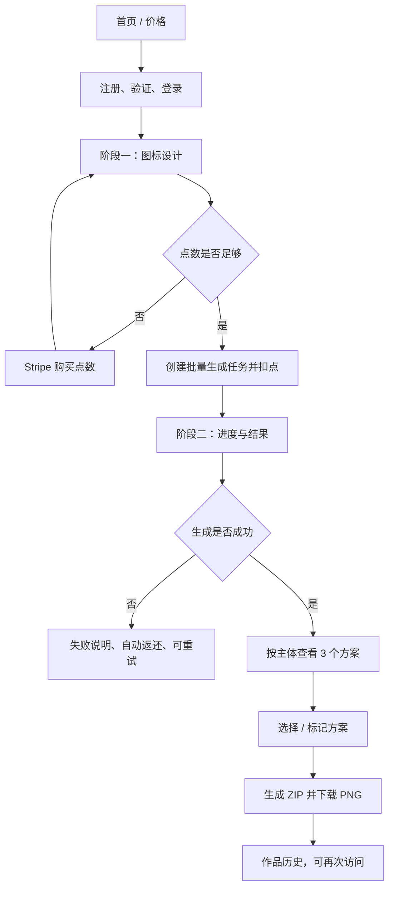

# Bamboo IconGen 产品需求文档（PRD）

文档版本：2.0
产品阶段：MVP 需求基线
界面语言：英文优先，支持中英文切换
更新时间：2026-08-20

## 1. 产品定位

Bamboo IconGen 是面向海外独立开发者、产品经理和小团队的批量 UI 图标生成网站。用户输入一个或多个图标主体，选择颜色、背景、图标设计风格和输出尺寸，系统使用平台方配置的 Icon Skill 与图片模型，为每个主体生成 3 个方案。用户在结果页选择满意方案，并下载 PNG 压缩包。

本版本替代“单次只生成一个 App Icon、返回 4 个方向”的旧范围。新核心单位为：

```text
一次生成任务 = N 个图标主体 × 每个主体 3 个方案
```

## 2. 产品目标与非目标

### 2.1 目标

- 用结构化设置引导非设计专业用户形成清晰、统一的图标设计方向。
- 支持一次提交多个 UI 图标主体，减少逐个填写和重复设置。
- 让同一批图标共享视觉规则，并为每个主体提供 3 个可比较方案。
- 完成注册、购买点数、生成、查看进度、选择结果和 ZIP 下载的商业闭环。
- 模型、API Key、Skill 和内部提示词由平台提供方统一配置并可替换。

### 2.2 MVP 不包含

- SVG、Icon Font、Figma 组件或原生工程资源导出。
- 浏览器内像素级编辑器。
- 用户自行配置模型、API Key 或 Skill。
- 公开作品社区、团队空间、订阅制。
- 上传参考图；列为后续能力。

## 3. 用户与角色

| 角色 | 主要能力 |
| --- | --- |
| 访客 | 浏览首页、价格、注册与登录 |
| 未验证用户 | 验证邮箱、退出；不能生成或支付 |
| 已验证用户 | 购买点数、批量生成、查看作品、下载 PNG ZIP、管理账户 |
| 受限用户 | 查看账户与历史；不能新增生成或支付 |
| 管理员 | 查询用户、生成任务、订单、点数和审计记录，执行受控运营操作 |

## 4. 六个业务模块

| 模块 | 核心职责 | 详细需求 |
| --- | --- | --- |
| 1. 用户信息 | 资料、余额摘要、账户状态、账户删除 | [用户信息、登录与账户需求](./user-auth-account-requirements.md) |
| 2. 登录与账户 | 注册、验证、登录、会话、找回密码、权限拦截 | [用户信息、登录与账户需求](./user-auth-account-requirements.md) |
| 3. 图片生成 | 多主体、颜色与背景、分类设置、尺寸、进度、Skill 与模型调用 | [图片生成模块需求](./icon-generation-requirements.md) |
| 4. 作品与下载 | 历史、任务详情、3 方案选择、主方案标记、ZIP 下载 | [作品、支付与运营模块需求](./works-billing-admin-requirements.md#1-作品与下载模块) |
| 5. 点数与 Stripe 支付 | 点数包、Checkout、Webhook、扣点、返还、账本 | [作品、支付与运营模块需求](./works-billing-admin-requirements.md#2-点数与-stripe-支付模块) |
| 6. 最小运营支持 | 任务查询/重试、订单与 Webhook 查询、人工调点和审计 | [作品、支付与运营模块需求](./works-billing-admin-requirements.md#3-最小运营支持模块) |

## 5. 两阶段核心体验

### 阶段一：图标设计 `/create`

用户依次完成：

1. 添加一个或多个图标主体。
2. 设置主体颜色：纯色或渐变；渐变展示颜色节点和方向。
3. 选择是否需要背景；开启后显示背景容器分类和背景颜色设置。
4. 选择一套图标设计风格，并做有限的风格微调。
5. 选择常用输出尺寸。
6. 查看结构化设计摘要与提示词语义预览。
7. 确认预计点数并提交生成。

### 阶段二：生成结果预览与下载 `/icons/[jobId]`

1. 页面显示任务级百分比、当前阶段和主体完成数。
2. 每个图标主体独占一行，一行展示 3 个生成方案。
3. 用户可勾选任意方案进入批量下载选择集。
4. 底部固定操作栏展示已选数量和“Download selected as ZIP”。
5. 未选择任何方案时禁止下载并显示明确错误。
6. 离开页面后任务继续，用户可从“我的图标”返回。

## 6. 完整业务闭环



## 7. 全局业务规则

### 7.1 生成与点数

- 新用户首次建立完整账户后获得 6 点体验点数，可生成 6 个图标主体、共 18 个方案。
- 体验点数发放、余额更新和 `signup_bonus` 账本必须事务一致且幂等。
- 1 个图标主体固定包含 3 个方案，整体消耗 1 点；不按单个方案拆分收费。
- 前端展示预计消耗，但服务端以主体数量、当前价格版本和账户余额重新计算。
- 创建任务、扣点和写入账本必须在同一数据库事务中完成。
- 系统自动补齐或重试同一主体的缺失方案不额外扣点。
- 一个主体最终未完整交付 3 个方案时，整笔返还该主体的 1 点；已经生成的可用结果可继续展示。
- 用户主动重新生成一组新的 3 个方案时，按新主体生成操作扣除 1 点。
- 同一幂等键不得重复创建任务或重复扣点。
- 购买点数和新用户赠送的 6 点均永久有效；MVP 不实现点数到期和扣点有效期排序。
- 每个用户最多同时存在 1 个 `queued` 或 `processing` 生成任务；期间可以继续编辑下一份本地草稿，但不能再次提交。
- Generate 提交成功并完成扣点后，用户不可主动取消任务；系统失败仍按自动重试和返还规则处理。

首发点数包：

| 点数包 | USD 价格 | 点数 | 可生成主体数 | 每主体价格 |
| --- | ---: | ---: | ---: | ---: |
| Starter | `$2.99` | 30 | 30 | `$0.10` |
| Maker | `$6.49` | 75 | 75 | `$0.09` |
| Studio | `$12.99` | 180 | 180 | `$0.07` |

以上为首发测试价，价格必须版本化；上线后根据模型成本、Stripe 手续费、存储、失败率和实际转化复核毛利。

### 7.2 图片与下载

- MVP 只交付 PNG；背景开启时输出带背景 PNG，背景关闭时输出透明背景 RGBA PNG。
- 用户选择的尺寸用于生产导出；系统保留高分辨率母版，再派生常用尺寸。
- 所有结果存储为私有资源，预览和下载使用短时授权 URL。
- ZIP 只包含当前用户有权访问且明确选中的结果。
- 用户作品从生成完成时间起保留 30 天；页面显示到期时间，过期后删除图片资产和关联临时归档。
- 用户提交删除账户后可在 30 天删除宽限期内打包下载仍未过期的用户资产。

### 7.3 分类设置项

- 附件《UI图标生成器分类体系》用于辅助筛选首版设置项，不直接成为产品运行数据。
- 共享设置目录固定为版本化的 10 个风格预设和 3 组兼容微调项；App 图标页面展示除线性图标外的 9 种风格，包含稳定 ID、中英文标签、预览资源和 style spec 路由。
- 前端不得直接把附件表格或显示文案拼接为最终模型提示词。
- 10 维度、266 项清单只作为未来研究参考；MVP 不提供高级模式，也不在接口中接受这些选项。

### 7.4 模型与 Skill

- 普通用户只选择产品允许的设计参数，不能选择供应商、模型、API Key 或内部 Skill。
- 首发模型配置为 `gpt-image-2`、`medium` 质量；配置由平台方统一管理。
- 后端将用户输入规范化为 `GenerationSpec`，由当前 Skill 按用途模板、风格 style spec、共享生产边界和方案差异编译成结构化模型提示词。
- 每个任务和结果记录 Provider、模型、Skill、核心设置与价格版本，便于追溯与复现。
- 产品只支持通用 UI 图标创作，不承诺复刻知名品牌 Logo、第三方商标或受保护角色。
- 对违法、仿冒、侵权导向和受保护角色请求执行提交前后内容安全检查；MVP 的误判申诉通过支持邮箱处理。

### 7.5 国际化与无障碍

- 默认英文，用户可切换中文；选择值使用稳定 ID，不使用翻译文案作为接口值。
- 表单支持键盘、明确 Label、错误聚焦和至少 44px 的可点击区域。
- 手机、桌面与 200% 文字缩放下完成核心流程。

## 8. 页面与跳转

| 页面 | 路由 | 主要进入方式 | 主要离开方式 |
| --- | --- | --- | --- |
| 首页 | `/` | 直接访问 | 登录；主 CTA 访问创建页时，访客先进入登录 |
| 价格 | `/pricing` | 导航、点数不足 | Stripe Checkout 或返回创建 |
| 登录/注册 | `/auth/*` | 受保护页拦截 | 原目标页或 `/create` |
| 图标设计 | `/create` | 主 CTA、历史再次生成 | `/icons/[jobId]` 或 `/pricing` |
| 我的图标 | `/icons` | 登录态顶部导航 | 任务详情或新建 |
| 结果预览与下载 | `/icons/[jobId]` | 创建成功、历史列表 | 下载、再次生成、历史 |
| 账户 | `/account` | 用户菜单“个人信息” | 修改显示名称或从余额卡片进入价格页；删除账户入口暂时隐藏 |
| 支付结果 | `/billing/result` | Stripe 返回 | 创建页或账户 |
| 最小运营支持 | `/admin/operations` | 管理员入口 | 任务、订单与调点处理 |

## 9. 核心状态模型

生成任务状态：

```text
draft → queued → processing → completed
                    ├→ partial
                    └→ failed
```

- `draft`：前端尚未提交，不写正式任务。
- `queued`：已扣点并成功进入处理队列。
- `processing`：至少一个子生成单元已领取。
- `completed`：全部主体均至少有可用结果，且计划的生成单元处理结束。
- `partial`：部分主体无可用结果；展示已有结果和返还说明。
- `failed`：没有可交付结果或任务不可恢复失败。

## 10. 核心指标

- 注册、邮箱验证和首次生成转化率。
- 创建页开始到提交的完成率、各设置步骤流失率。
- 任务成功率、部分成功率、P50/P95 生成耗时。
- 每主体 3 个方案的被选率与首选标记率。
- ZIP 下载成功率、无选择下载错误率。
- 点数购买转化、Webhook 入账时延、退款率。
- 按模型、Skill 和核心设置版本的成本与成功率。

## 11. MVP 完成定义

所有模块进入开发前，还必须通过[需求完整性检查规则](./requirements-completeness-rules.md)，明确对象与标识、状态机、幂等、权限、异常、生命周期、导出和验收用例。

- 六个业务模块的 P0 功能形成可运行闭环。
- 一次任务支持多个主体，每主体稳定产生 3 个方案或给出可追溯失败结果。
- 两阶段页面状态、刷新恢复、离开后返回和异常恢复完整。
- 点数扣除、购买入账和失败返还幂等且可审计。
- 用户只能访问和下载自己的作品。
- 英文和中文核心流程、桌面和移动端端到端测试通过。
- 图标设计风格预设、微调项、稳定 ID 和版本已冻结并通过自动校验。
